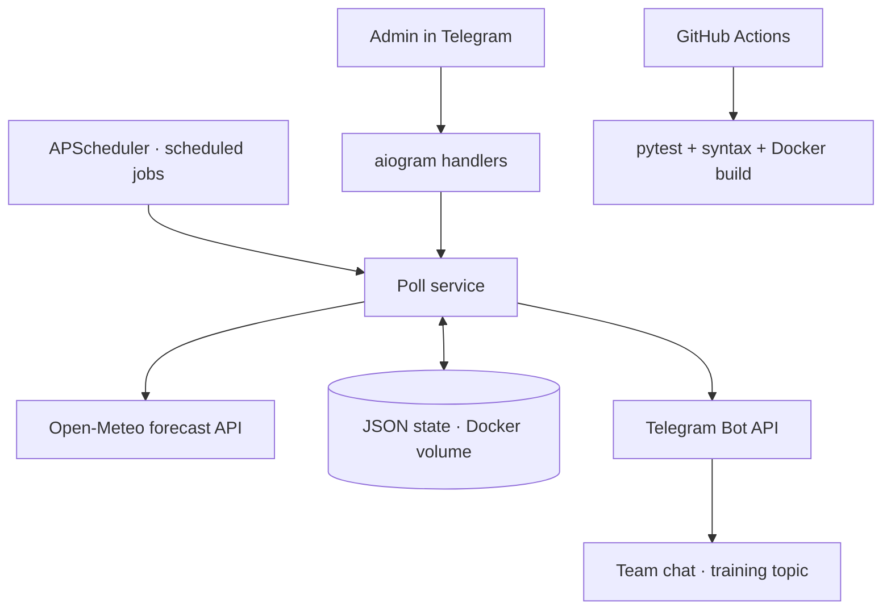
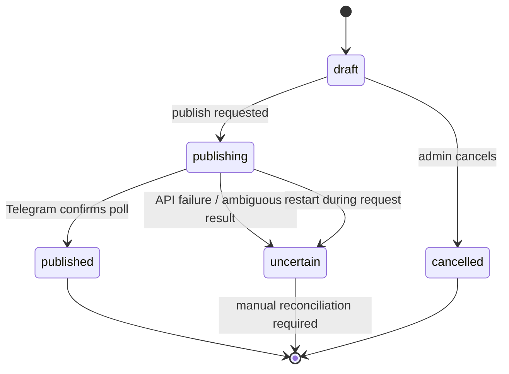

# 🏃 Weekly Poll Bot

**Reliable Telegram attendance polls for weekly team training — automated, weather-aware, and restart-safe.**


Python bot for scheduling Telegram attendance polls. Supports admin confirmation, weather forecasts, and persistent state to prevent duplicate publication.


## ✨ Highlights

- **Automated workflow:** scheduled admin confirmation, reminder, and publication.
- **Editable training details:** date, time, and venue.
- **Weather forecast:** Open-Meteo hourly forecast for the training location and time; unavailable weather does not prevent publishing.
- **Restart-safe state:** atomic JSON writes to a named Docker volume.
- **Duplicate prevention:** persistent `draft → publishing → published` transitions and an in-process async lock.
- **Failure-aware publishing:** ambiguous Telegram API results enter `uncertain` and require manual reconciliation rather than blind retries.
- **Operational visibility:** container logs, healthcheck, optional host-level watchdog, and admin `/status`.
- **Automated checks:** pytest, Python syntax verification, Docker Compose validation and image build in GitHub Actions.

## 🏗️ Architecture



### Publication state machine



**Delivery guarantee:** at-most-once automatic publication *attempt*, not exactly-once delivery. Telegram and the local state file cannot participate in a shared transaction. Never manually reset `publishing` or `uncertain` without checking the chat.

## 🛠️ Tech stack

| Layer | Technology |
| --- | --- |
| Bot / async runtime | Python 3.13, aiogram 3, asyncio |
| Scheduling | APScheduler 3, configured timezone |
| Weather | Open-Meteo, httpx |
| Persistence | Atomic JSON state, Docker named volume |
| Deployment | Docker, Docker Compose, non-root container |
| Quality | pytest, pytest-asyncio, GitHub Actions |
| Operations | Docker logs, healthcheck, host watchdog |

## 🚀 Quick start

**Requirements:** Docker Engine with Docker Compose v2 and a Telegram bot token.

```bash
git clone <REPOSITORY_URL>
cd weekly-poll-bot
cp .env.example .env
# Fill in BOT_TOKEN, ADMIN_ID, GROUP_ID and TOPIC_ID in .env
docker compose up -d --build
docker compose ps
docker compose logs --tail=50 weekly-poll-bot
```

**Important for existing installations:** check whether the next poll already exists *before* starting this version. See [migration and operations](docs/OPERATIONS.md). Never run multiple poller instances with the same token.

### Configuration

| Variable | Purpose |
| --- | --- |
| `BOT_TOKEN` | Telegram bot token (secret) |
| `ADMIN_ID` | Telegram administrator ID |
| `GROUP_ID` | Target Telegram group ID |
| `TOPIC_ID` | Training topic/thread ID |
| `TIMEZONE` | Scheduler and forecast timezone (default `UTC`) |
| `DEFAULT_TIME` | Training time (default `18:00`) |
| `DEFAULT_PLACE` | Training venue |
| `WEATHER_ENABLED` | Enable/disable weather forecast |
| `WEATHER_LATITUDE`, `WEATHER_LONGITUDE` | Forecast coordinates |
| `STATE_PATH` | Persistent JSON path (default `/data/state.json`) |

**Never commit `.env`, bot tokens, or user data.** The public `.env.example` contains only placeholders.

## 🧪 Tests and CI

```bash
python -m pip install -r requirements-dev.txt
python -m pytest -q
python -m compileall -q app tests
docker compose config --quiet
```

The test suite covers date selection, state persistence, weather parsing, and prevention of duplicate publication. CI executes on pushes and pull requests. Tests mock Telegram calls and do not publish real polls.

## 📅 Schedule

The scheduler runs the approval, reminder, and publication jobs each week. Configure the timezone and event details in `.env`.

## 🔒 Reliability and operational notes

- The Docker healthcheck checks that the process is alive; it does **not** verify Telegram API connectivity.
- The existing host-side watchdog can provide independent outage notifications.
- A state of `publishing` after a crash, or `uncertain` after an API exception, requires manual investigation.
- The bot is designed for a **single active instance**. Its JSON store is not a distributed lock.
- Open-Meteo API usage must comply with the provider's applicable terms.

See [Operations & recovery](docs/OPERATIONS.md) for checks, backups, and migration guidance.

## 🗺️ Roadmap

- [x] Scheduled Telegram training polls
- [x] Weather forecast for training time
- [x] Persistent state across container restarts
- [x] Duplicate publication protection
- [x] Unit tests and GitHub Actions
- [ ] More end-to-end failure-path tests
- [ ] Structured application metrics
- [ ] Automated backup / restore drill

